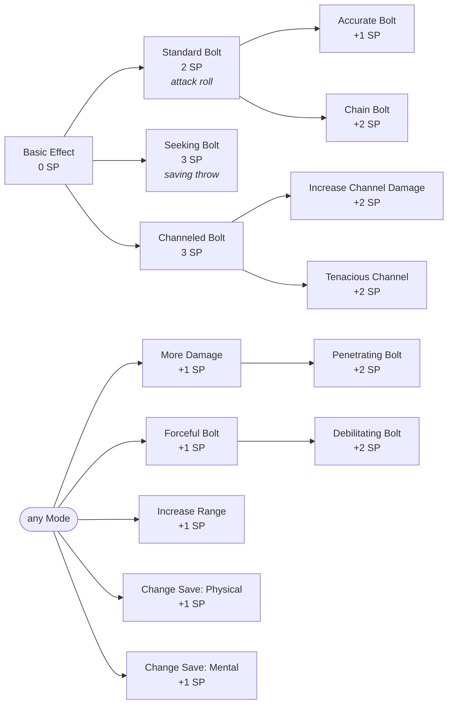

<!-- markdownlint-disable MD041 -->
### 6.2 Bolt

#### Basic Effect (0 SP)

| Property      | Value                                                              |
|:--------------|:-------------------------------------------------------------------|
| **Cast Time** | 1 Action                                                           |
| **Range**     | 60 ft                                                              |
| **Duration**  | Instantaneous                                                      |
| **Effect**    | Make a ranged spell attack. Hit: Target takes 1d10 Essence damage. |

#### What you can buy

`Standard Bolt` rolls to hit, so `Accurate Bolt` and `Chain Bolt` hang off it. Every other Mode makes the target save instead.

#### Mode: Standard Bolt ✦ 2 SP

| Property     | Value                                                              |
|:-------------|:-------------------------------------------------------------------|
| **Cast**     | 1 Action                                                           |
| **Range**    | 60 ft                                                              |
| **Duration** | Instantaneous                                                      |
| **Effect**   | Make a ranged spell attack vs one target. Hit: 3d8 Essence damage. |

##### Standard Bolt Enhancements

| Enhancement   | SP Cost | Effect                                                                                                                                                           |
|:--------------|:--------|:-----------------------------------------------------------------------------------------------------------------------------------------------------------------|
| Accurate Bolt | +1 SP   | Gain Advantage on the ranged spell attack roll.                                                                                                                  |
| Chain Bolt    | +2 SP   | On hit, bolt leaps to a second target within 15 ft (new attack roll). Hit: half original damage (round down). (*Stackable*: +2 SP/target, half previous damage). |

#### Mode: Seeking Bolt ✦ 3 SP

| Property     | Value                                                                                                  |
|:-------------|:-------------------------------------------------------------------------------------------------------|
| **Cast**     | 1 Action                                                                                               |
| **Range**    | 60 ft                                                                                                  |
| **Duration** | Instantaneous                                                                                          |
| **Effect**   | Target makes a Dexterity saving throw. Fail: 3d8 Essence damage. Success: Half damage. No attack roll. |

#### Mode: Channeled Bolt ✦ 3 SP

| Property     | Value                                                                                                                                                                                                                                                                                                                                                                                                                                                                                                                                                                                                                  |
|:-------------|:-----------------------------------------------------------------------------------------------------------------------------------------------------------------------------------------------------------------------------------------------------------------------------------------------------------------------------------------------------------------------------------------------------------------------------------------------------------------------------------------------------------------------------------------------------------------------------------------------------------------------|
| **Cast**     | 1 Action                                                                                                                                                                                                                                                                                                                                                                                                                                                                                                                                                                                                               |
| **Range**    | 60 ft                                                                                                                                                                                                                                                                                                                                                                                                                                                                                                                                                                                                                  |
| **Duration** | Concentration, up to 1 min                                                                                                                                                                                                                                                                                                                                                                                                                                                                                                                                                                                             |
| **Effect**   | Choose delivery: **Attack Channel** (Make a spell attack. On hit: target takes 2d8 Essence damage and you establish a channel to them.) OR **Save Channel** (Target makes a Dexterity saving throw. On fail: takes 2d8 Essence damage and you establish a channel to them. On success: takes half damage and no channel is established). While concentrating, you can use your Action on subsequent turns to deal 2d8 Essence damage to the channeled target (if visible and within range). The channel ends if you lose concentration or use a different spell/effect that requires your Action on a subsequent turn. |

##### Channeled Bolt Enhancements

| Enhancement             | SP Cost | Effect                                                                                                     |
|:------------------------|:--------|:-----------------------------------------------------------------------------------------------------------|
| Increase Channel Damage | +2 SP   | Increase subsequent Action damage by +1d8. (*Stackable*).                                                  |
| Tenacious Channel       | +2 SP   | Concentration is not broken if you use your Action to cast a non-attack spell or take a non-Attack action. |

#### General Enhancements (Bolt)

Available with any Mode. The indented rows require the enhancement above them.

| Enhancement            | SP Cost | Effect                                                                                                                                                                                         |
|:-----------------------|:--------|:-----------------------------------------------------------------------------------------------------------------------------------------------------------------------------------------------|
| More Damage            | +1 SP   | Increase the initial damage dice by +1d8. (*Stackable*) (Applies to Standard, Seeking, Channeled initial hit).                                                                                 |
| ↳ Penetrating Bolt     | +2 SP   | (Requires: More Damage) The spell's damage ignores resistance to its damage type.                                                                                                              |
| Forceful Bolt          | +1 SP   | On hit (Standard) or failed initial save (Seeking/Channeled), primary target pushed 10 ft away from the caster.                                                                                |
| ↳ Debilitating Bolt    | +2 SP   | (Requires: Forceful Bolt) On hit (Standard) or failed initial save (Seeking/Channeled), primary target makes Con save vs Spell DC or suffers Essence status until start of **your** next turn. |
| Increase Range         | +1 SP   | Doubles the spell's range. (*Stackable*).                                                                                                                                                      |
| Change Save (Physical) | +1 SP   | (Applies To: any cast that uses a saving throw) Changes the required save to Strength or Constitution.                                                                                         |
| Change Save (Mental)   | +1 SP   | (Applies To: any cast that uses a saving throw) Changes the required save to Wisdom, Intelligence, or Charisma.                                                                                |
