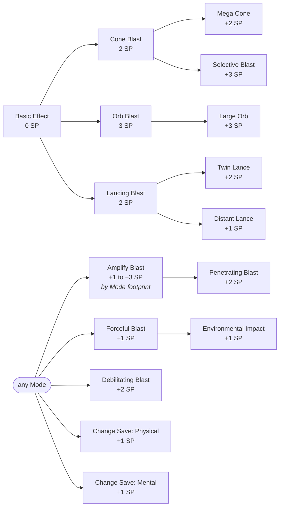

<!-- markdownlint-disable MD041 -->
### 6.4 Blast

#### Basic Effect (0 SP)

| Property      | Value                                                                                        |
|:--------------|:---------------------------------------------------------------------------------------------|
| **Cast Time** | 1 Action                                                                                     |
| **Range**     | Self (10-ft cone)                                                                            |
| **Duration**  | Instantaneous                                                                                |
| **Effect**    | Creatures in cone make Dex save vs Spell DC. Fail: 1d8 Essence damage. Success: Half damage. |

#### What you can buy

#### Mode: Cone Blast ✦ 2 SP

| Property     | Value                                                                            |
|:-------------|:---------------------------------------------------------------------------------|
| **Cast**     | 1 Action                                                                         |
| **Range**    | Self (20-foot cone)                                                              |
| **Duration** | Instantaneous                                                                    |
| **Effect**   | Creatures in cone make Dex save. Fail: 2d8 Essence damage. Success: Half damage. |

##### Cone Blast Enhancements

| Enhancement     | SP Cost | Effect                                                          |
|:----------------|:--------|:----------------------------------------------------------------|
| Mega Cone       | +2 SP   | Increase cone length to 30 feet.                                |
| Selective Blast | +3 SP   | Choose creatures in the cone; they are unaffected by the blast. |

#### Mode: Orb Blast ✦ 3 SP

| Property     | Value                                                                              |
|:-------------|:-----------------------------------------------------------------------------------|
| **Cast**     | 1 Action                                                                           |
| **Range**    | 60 ft (10-foot radius sphere centred on point)                                     |
| **Duration** | Instantaneous                                                                      |
| **Effect**   | Creatures in sphere make Dex save. Fail: 2d8 Essence damage. Success: Half damage. |

##### Orb Blast Enhancements

| Enhancement | SP Cost | Effect                      |
|:------------|:--------|:----------------------------|
| Large Orb   | +3 SP   | Increase radius to 15 feet. |

#### Mode: Lancing Blast ✦ 2 SP

| Property     | Value                                                                                                                                                                               |
|:-------------|:------------------------------------------------------------------------------------------------------------------------------------------------------------------------------------|
| **Cast**     | 1 Action                                                                                                                                                                            |
| **Range**    | Self (Line 25 ft L x 5 ft W)                                                                                                                                                        |
| **Duration** | Instantaneous (Lingers until start of your next turn)                                                                                                                               |
| **Effect**   | Creatures in line make Dex save. Fail: 2d8 Essence damage. Success: Half damage. Line persists; creatures entering/ending turn repeat save vs 2d8 Essence damage (half on success). |

##### Lancing Blast Enhancements

| Enhancement   | SP Cost | Effect                                                                                                  |
|:--------------|:--------|:--------------------------------------------------------------------------------------------------------|
| Twin Lance    | +2 SP   | Create two separate Lancing Blasts with this casting. While applied, Amplify Blast costs +2 SP per die. |
| Distant Lance | +1 SP   | The line is centred on a point within 60 ft instead of originating from you.                            |

#### General Enhancements (Blast)

Available with any Mode. The indented rows require the enhancement above them.

| Enhancement            | SP Cost     | Effect                                                                                                                                                                                                            |
|:-----------------------|:------------|:------------------------------------------------------------------------------------------------------------------------------------------------------------------------------------------------------------------|
| Amplify Blast          | +1 to +3 SP | Increase initial damage dice by +1d8. Cost depends on the Mode: **+1 SP** with Lancing Blast, **+2 SP** with Cone Blast, Orb Blast, or Twin Lance, **+3 SP** if Mega Cone or Large Orb is applied. (*Stackable*). |
| ↳ Penetrating Blast    | +2 SP       | (Requires: Amplify Blast) The blast's damage ignores resistance to its damage type.                                                                                                                               |
| Forceful Blast         | +1 SP       | Creatures failing the initial save are pushed 10 ft away from the origin/centre.                                                                                                                                  |
| ↳ Environmental Impact | +1 SP       | (Requires: Forceful Blast) The area affected by the initial blast becomes difficult terrain until the start of your next turn.                                                                                    |
| Debilitating Blast     | +2 SP       | Creatures failing initial save suffer the status effect until end of **your** next turn.                                                                                                                          |
| Change Save (Physical) | +1 SP       | Changes the required saving throw from Dexterity to Strength or Constitution (choose when learning).                                                                                                              |
| Change Save (Mental)   | +1 SP       | Changes the required saving throw from Dexterity to Wisdom or Intelligence (choose when learning).                                                                                                                |
