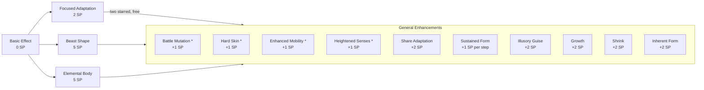

<!-- markdownlint-disable MD041 -->
### 6.16 Adapt Self

#### Basic Effect (0 SP)

| Property      | Value                                                                                                  |
|:--------------|:-------------------------------------------------------------------------------------------------------|
| **Cast Time** | 1 Action                                                                                               |
| **Range**     | Self                                                                                                   |
| **Duration**  | 1 minute                                                                                               |
| **Effect**    | Gain one: +5 ft speed; OR Adv on Athletics (climb/swim); OR unarmed strikes deal 1d4 + Str mod damage. |

#### What you can buy

Starred Enhancements are the ones **Focused Adaptation** can take two of at no extra cost. Everything else adds its SP to the Mode cost.

#### Mode: Focused Adaptation ✦ 2 SP

| Property     | Value                                                                                                                                  |
|:-------------|:---------------------------------------------------------------------------------------------------------------------------------------|
| **Cast**     | 1 Action                                                                                                                               |
| **Range**    | Self                                                                                                                                   |
| **Duration** | Concentration, up to 10 min                                                                                                            |
| **Effect**   | Choose **two** enhancements from General Enhancements (marked with \*). Apply their effects for the duration at no additional SP cost. |

#### Mode: Beast Shape ✦ 5 SP

| Property     | Value                                                                                                                                                                                                                                                                                   |
|:-------------|:----------------------------------------------------------------------------------------------------------------------------------------------------------------------------------------------------------------------------------------------------------------------------------------|
| **Cast**     | 1 Action                                                                                                                                                                                                                                                                                |
| **Range**    | Self                                                                                                                                                                                                                                                                                    |
| **Duration** | Concentration, up to 10 min                                                                                                                                                                                                                                                             |
| **Effect**   | Transform into a partial bestial form. Gain: Natural weapons (1d8 + Spell Mod Essence damage, magical), AC becomes 15 (use your armour if higher), Climb/Swim speed = walk speed (breathe underwater if apt), Adv vs Grapple/Restrain, Darkvision 60ft, Adv Perception (hearing/smell). |
| **Limits**   | Cannot cast spells with Verbal components or perform tasks requiring fine motor control unless form allows (GM discretion).                                                                                                                                                             |

#### Mode: Elemental Body ✦ 5 SP

| Property     | Value                                                                                                                                                                                                                                                                                        |
|:-------------|:---------------------------------------------------------------------------------------------------------------------------------------------------------------------------------------------------------------------------------------------------------------------------------------------|
| **Cast**     | 1 Action                                                                                                                                                                                                                                                                                     |
| **Range**    | Self                                                                                                                                                                                                                                                                                         |
| **Duration** | Concentration, up to 10 min                                                                                                                                                                                                                                                                  |
| **Effect**   | Body partially transforms into Essence type. Gain: Resistance to Essence damage type, Unarmed strikes deal 1d10 magical Essence damage, Move through 1-inch spaces without squeezing, Ignore non-magical difficult terrain, Retaliation damage (Spell Mod Essence) on melee hit within 5 ft. |
| **Limits**   | Minor environmental interactions (ignite, freeze, dim light) based on Essence (GM discretion). May appear obviously magical.                                                                                                                                                                 |

#### General Enhancements (Adapt Self)

*(Add SP cost to Mode cost, unless used via Focused Adaptation\*)*

| Enhancement         | SP Cost      | Effect                                                                                                                      |
|:--------------------|:-------------|:----------------------------------------------------------------------------------------------------------------------------|
| Battle Mutation\*   | +1 SP        | Natural weapons (or unarmed strikes if none granted) deal 1d8 magical Essence damage.                                       |
| Hard Skin\*         | +1 SP        | Gain +1 bonus to AC. (*Stackable, max +2 total bonus*).                                                                     |
| Share Adaptation    | +2 SP        | Range becomes Touch. One willing creature gains the chosen Mode’s effects instead. (*Cannot target self*).                  |
| Enhanced Mobility\* | +1 SP        | Gain both climb and swim speed = walking speed; can breathe air and water.                                                  |
| Heightened Senses\* | +1 SP        | Gain darkvision 60 ft; gain advantage on Wisdom (Perception) checks.                                                        |
| Sustained Form      | +1 SP / step | Increase Concentration duration step (10 min → 1 hour → 8 hours).                                                           |
| Illusory Guise      | +2 SP        | Change appearance (visual only). Adv on Deception checks for disguise. Duration 1 hour, no Conc. (*Can add or cast alone*). |
| Growth              | +2 SP        | Size becomes Large (if M/S). Gain Adv Str checks/saves, +5 ft reach, weapon/unarmed +1d4 damage.                            |
| Shrink              | +2 SP        | Size becomes Small (if M/L). Gain Adv Dex checks/saves & Stealth, +1 AC & attack rolls.                                     |
| Inherent Form       | +2 SP        | Removes the need for Concentration.                                                                                         |
